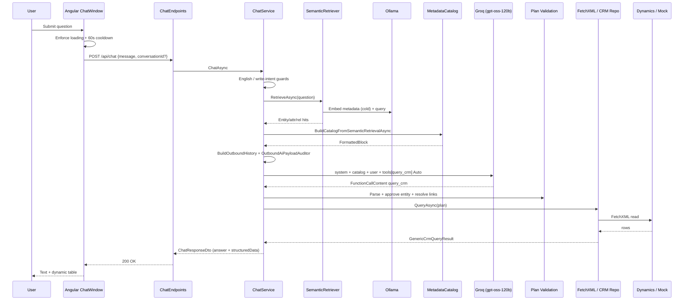
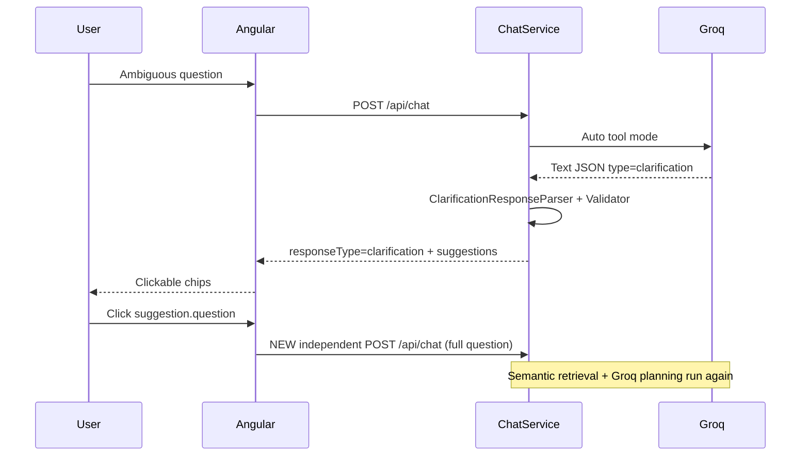
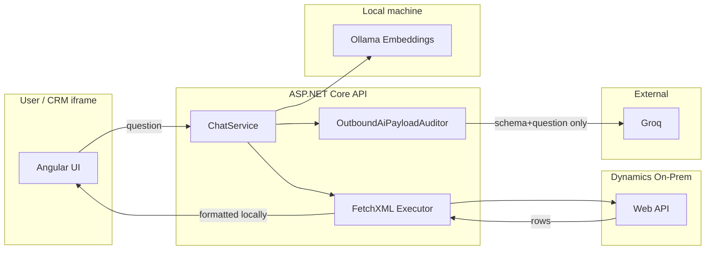

# WE CRM AI Assistant POC — Detailed Technical Architecture

**Document:** 02-Detailed-Technical-Architecture  
**Companion to:** Sections 3–16 of the architecture audit assignment  
**Baseline date:** 2026-11-05  
**Rule:** Describes the system **as implemented**. Planned work is labeled explicitly.

---

## 1. Repository Map

```text
d:\CRM POC\
├── CrmAiPoc.slnx                          # Solution entry
├── README.md                              # Partially outdated vs code (see §1.1)
├── src\CrmAiPoc.Api\                      # ASP.NET Core API (.NET 8)
│   ├── Ai\                                # Chat orchestration, tools, providers, clarification
│   ├── Configuration\                     # Options bindings
│   ├── Crm\
│   │   ├── Dynamics\                      # HTTP client + connectivity
│   │   ├── Generic\                       # Query plan, FetchXML, repos, formatters
│   │   ├── Metadata\                      # Discovery, catalog, relationships, semantic/
│   │   ├── Mock\                          # Seed data
│   │   ├── Query\                         # Date range resolution
│   │   └── Validation\                    # Argument validation helpers
│   ├── Endpoints\                         # /api/chat, diagnostics
│   ├── Models\                            # DTOs
│   ├── Security\                          # AuthZ, loopback middleware, allowlist
│   └── Program.cs                         # DI + pipeline
├── frontend\crm-ai-assistant-ui\          # Angular 19 chat UI
│   ├── CRM-DEPLOY.md                      # Web resource packaging
│   └── src\app\features\chat\             # Chat window/input/message/table
├── tests\CrmAiPoc.Tests\                  # xUnit suite
├── tools\CrmReportingEntityDiscovery\     # Offline discovery utility
├── docs\                                  # Phase reports + this architecture-review/
└── artifacts\                             # Build/test output (not product code)
```

### 1.1 Documentation drift (important)

Root `README.md` still mentions older concepts (`get_sales_orders`, `UseFunctionInvocation` round-trips of CRM rows, Arabic-first framing, older BaseUrl org path). **Current code** uses single-stage `query_crm`, no CRM-row round-trip to the model, English-primary UX with Arabic-script rejection in chat input policy.

### 1.2 Project responsibilities

| Project | Responsibility | Depends on |
|---------|----------------|------------|
| `CrmAiPoc.Api` | HTTP API, AI planning orchestration, CRM metadata + FetchXML execution | MEAI, OpenAI SDK, Dynamics Web API, Ollama |
| `crm-ai-assistant-ui` | Chat UX, clarification chips, tables, CRM iframe packaging | API via HTTP |
| `CrmAiPoc.Tests` | Unit/integration/live tests | Api project |
| `CrmReportingEntityDiscovery` | Supporting discovery tool | Separate |

---

## 2. End-to-End Request Lifecycle

### 2.1 Sequence (happy path — tool call)



### 2.2 Clarification path



### 2.3 Step-by-step with evidence

| Step | Component | Method | Inputs | Outputs | Failure behavior |
|------|-----------|--------|--------|---------|------------------|
| 1 | `ChatInputComponent` / chips | `onSubmit` / click | text | `send` event | disabled when loading/cooldown |
| 2 | `ChatWindowComponent` | `onSend` | message | HTTP via `ChatService` | ignores if `inputBlocked` |
| 3 | `ChatService` (Angular) | `sendMessage` | message, conversationId | `ChatResponse` | maps HTTP errors to Error |
| 4 | `ChatEndpoints` | `MapPost("/chat")` | `ChatRequestDto` | `ChatResponseDto` | 400/503/500 |
| 5 | `ChatService` (API) | `ChatAsync` → `ChatCoreAsync` | request, session | DTO | semantic fail refuses AI; provider errors classified |
| 6 | `SemanticCrmMetadataRetriever` | `RetrieveAsync` | question | hits / Error | Ollama errors → Error; ChatService blocks Groq |
| 7 | `CrmAiMetadataCatalogService` | `BuildCatalogFromSemanticRetrievalAsync` | retrieval | FormattedBlock | empty/fail refuses AI |
| 8 | `BuildOutboundHistory` | static | question, catalog | 2–3 ChatMessages | auditor throw if unsafe |
| 9 | `LazyGroqChatClient` | `GetResponseAsync` | messages, ChatOptions | ChatResponse | HTTP errors bubble |
| 10a | Clarification | `HandleTextOrClarificationResponse` | model text | suggestions / answer | invalid JSON → English fallback |
| 10b | Tool | `HandleQueryCrmAsync` | FunctionCallContent | CRM result DTO | validation messages; CRM errors |
| 11 | `DynamicsGenericCrmRepository` / Mock | `QueryAsync` | `CrmQueryPlan` | rows/count | auth + CRM errors |
| 12 | Angular message/table | render | structuredData | UI | error flag styling |

**Conversation IDs:** `ConversationStore.GetOrCreate` retains local session state (including pending relationship clarification). **Groq does not receive prior chat turns.**

**Frontend cooldown:** 60 seconds from request start (`ChatWindowComponent.RequestCooldownMs`) — UX only, not server-side.

---

## 3. Dependency Injection and Lifetimes

Registered in `Program.cs`:

| Service | Lifetime | Notes |
|---------|----------|-------|
| `ConversationStore` | Singleton | In-memory sessions |
| `CrmMetadataRegistry` | Singleton | Metadata cache |
| `EntityApprovalPolicy` | Singleton | Approved entities |
| `ICrmAiMetadataCatalogService` | Singleton | Catalog builder |
| `ICrmAuthorizationService` | Singleton | Read authorization |
| `IGenericCrmQueryBuilder` | Singleton | FetchXML builder |
| `FetchXmlAggregateBuilder` | Singleton | Aggregate FetchXML |
| `InMemorySemanticMetadataIndex` | Singleton | Vector index |
| `ISemanticCrmMetadataRetriever` | Singleton | Retrieval |
| `IOllamaEmbeddingClient` | Singleton | HTTP embeddings |
| `DynamicsCrmHttp` / Connectivity | Singleton | Always registered |
| `ICrmMetadataService` / `IGenericCrmRepository` | Singleton | Mock **or** Dynamics by config |
| `CrmMetadataWarmupHostedService` | Hosted | Post-start warmup |
| `LazyGroq/OpenAi/Gemini` | Singleton | Provider clients |
| `IChatClient` | Singleton factory | Selects by `Ai:Provider` |
| `CrmAiTools` | Scoped | Tool method host |
| `ChatService` | Scoped | Per-request orchestration |

Pipeline: CORS → `LoopbackOnlyMiddleware` → endpoints. Development also maps Swagger and `/api/diagnostics/semantic-metadata`.

---

## 4. Dynamics CRM Integration

### 4.1 Connectivity

- Config section `Crm`
- Example BaseUrl: `https://ecrmdev9.te.eg/ECRMPro/api/data/v9.1/`
- `UseDefaultCredentials: true` (Windows/AD) or optional `CRM_USERNAME` / `CRM_PASSWORD` / `CRM_DOMAIN`
- Live use requires `Crm:Provider=Dynamics365` **and** `EnableLiveIntegration=true` **and** non-empty `BaseUrl`
- Default committed `appsettings.json` uses **`Provider: Mock`**, `EnableLiveIntegration: false`

### 4.2 Metadata vs business queries

| Concern | Mechanism |
|---------|-----------|
| Entity/attribute/relationship discovery | Dynamics Web API EntityDefinitions (via `DynamicsCrmMetadataService`) |
| Business record reads | FetchXML submitted through generic repository |
| Cache | `CrmMetadataRegistry` + `MetadataCacheSeconds` (default 3600) |
| Warmup | `CrmMetadataWarmupHostedService` when enabled |

### 4.3 Approved entities (current configuration)

From `src/CrmAiPoc.Api/appsettings.json`:

`account`, `contact`, `lead`, `salesorder`, `opportunity`, `quote`, `invoice`, `salesorderdetail`, `product`, `campaign`, `te_serviceorder`

`ApprovedRelationships` is an empty array in config; relationship approval/labels are handled via metadata flags and `CrmRelationshipLabeler` / discovery.

Primary keys, display names, and EntitySetNames are **loaded from CRM metadata or mock seed** at runtime — not hardcoding a full schema in this document.

### 4.4 Polymorphic customer relationships (known case)

Metadata includes:

- `order_customer_accounts`: `salesorder.customerid` → `account.accountid`
- `order_customer_contacts`: `salesorder.customerid` → `contact.contactid`

Both share the polymorphic `customerid` lookup. Simultaneous INNER joins through both can yield **zero rows**. Current pipeline does **not** implement a dedicated mutual-exclusion validator; the model (and relationship clarification heuristics) are expected to avoid invalid combinations. Backend will execute schema-valid plans.

---

## 5. Semantic Retrieval and Local Embeddings

### 5.1 Algorithm

1. Ensure approved entities loaded.
2. Build documents (`MetadataDocumentBuilder`) for entity / attribute / relationship kinds.
3. Compute SHA-256 content hash; `InMemorySemanticMetadataIndex.EnsureBuiltAsync` single-flights rebuild.
4. Embed document texts in batches via Ollama `/api/embed`.
5. Embed query with `search_query:` prefix.
6. Score all vectors with cosine similarity; filter by `MinSimilarity`.
7. Take Top-K entities; scope attributes/relationships to selected entities; may add structural primaries.
8. Return hits used to build compact AI catalog.

### 5.2 Configuration (`SemanticMetadata` / `Ollama`)

| Setting | Default |
|---------|---------|
| Embedding model | `nomic-embed-text` |
| Dimensions | 768 |
| Ollama BaseUrl | `http://localhost:11434` |
| TopKEntities | 3 |
| TopKAttributesPerEntity | 20 |
| TopKRelationships | 10 |
| MinSimilarity | 0 |
| Index persistence | Process memory only |
| Concurrent rebuild | Single-flight (`SemaphoreSlim`); waiters reuse snapshot; only embedder reports `IndexRebuilt=true` |

### 5.3 Business vs technical framing

- **Business:** The system first finds which CRM *schema topics* match the question, so the AI planner is not overwhelmed with the entire org model.
- **Technical:** Local vector search over metadata documents; **not** search over CRM records.

### 5.4 Failure

Ollama/HTTP/timeout errors surface as `SemanticMetadataRetrievalResult.Error`. ChatService **refuses** to call Groq when retrieval fails or returns no entity hits.

Historical live observation (~2,548 documents, multi-minute cold build) is **historical**, not re-measured in this documentation cycle.

---

## 6. Groq AI Integration

### 6.1 Packages and model

- `Microsoft.Extensions.AI` 10.11.0
- `Microsoft.Extensions.AI.OpenAI` 10.11.0
- `OpenAI` 2.14.0
- Default model: `openai/gpt-oss-120b`
- Endpoint: `https://api.groq.com/openai/v1`
- SDK `ClientRetryPolicy(0)` — app owns timeout/retry

### 6.2 Outbound request structure

1. `ChatRole.System` — static `ChatService.SystemPrompt`
2. `ChatRole.System` — delimited metadata catalog block (when enabled/successful)
3. `ChatRole.User` — current question only
4. Tools: `[AIFunctionFactory.Create(_tools.query_crm)]`
5. `ToolMode = ChatToolMode.Auto`
6. `Temperature = 0.1f`
7. No `MaxOutputTokens` / `ResponseFormat` / reasoning options set by app

### 6.3 Provider failure taxonomy (`AiProviderFailureClassifier`)

| Kind | Examples | App retry? |
|------|----------|------------|
| Http429 / Http503 | rate limit, unavailable | Yes (bounded, max 2 attempts) |
| ClientTimeout | 60s CancelAfter | No second full wait |
| Http400 | `invalid_request` / `tool_use_failed` | No |
| ProviderLimit | context length | No |
| Network / Other | connection issues | No (unless classified transient) |

### 6.4 Known provider issue (historical / audited)

HTTP 400 `tool_use_failed`: attempted tool `'commentary'` not in `request.tools`. Phase 3.4 audit classifies this as **strongly supported** GPT-OSS Harmony channel / Groq parser behavior — **not** an app-registered tool. Exact `failed_generation` for CRM POC failures remains incompletely captured in logs.

---

## 7. `query_crm` Tool and Query Planning

### 7.1 Tool identity

- **Name:** `query_crm` (C# method name → MEAI `AIFunction.Name`)
- **Registration:** only tool on ChatOptions for chat
- **Required parameter:** `entity`
- **Operations:** `list` | `count` | `aggregate` (string; defaults list)
- **Optional:** select/filters/sort/limit/dateRange/aggregates/groupBy/linksJson/relatedFrom*, etc. (see `CrmAiTools.cs`)

### 7.2 Plan model

`CrmQueryPlan` is structured and non-executable (no embedded FetchXML). Parsed by `CrmQueryPlanParser` from tool arguments.

### 7.3 Responsibility split

| AI decides | Backend enforces |
|------------|------------------|
| Intent → operation | Approved entity canonicalize (no silent substitute of different business entity) |
| Fields, filters, sort, limit | Schema validation / allowlist |
| Aggregates / groupBy | FetchXML aggregate construction |
| Links / join purposes | Relationship resolution against metadata; clarification when ties |
| Clarification vs tool | Validate clarification JSON against catalog |

`CrmAiTools.query_crm` can execute CRM when invoked directly, but **ChatService planning path executes validated plans locally** and formats replies without returning rows to Groq.

---

## 8. Clarification Workflow

1. Groq text response parsed by `ClarificationResponseParser` (`type=clarification`, 2–4 suggestions with complete `question`).
2. `ClarificationSuggestionValidator` checks entity/attributes/relationships against **catalog sent to the model**.
3. DTO: `responseType: "clarification"`, `suggestions[]` with `label`, `question`, optional logical names.
4. Angular `ChatMessageComponent` renders chips; click emits full `question`.
5. `ChatWindowComponent.onClarificationSuggestion` → `onSend` → **new** `/api/chat`.

**Same-request second AI stage:** not used for clarification.  
**Pending relationship clarification:** separate session mechanism; user selection can resume execution **without** Groq.

`ChatToolMode.Auto` is required so the model may either call `query_crm` or return clarification text.

---

## 9. FetchXML Engine

### 9.1 Pipeline

`CrmQueryPlan` → `CrmRelationshipResolver` / discovery attach → `GenericCrmQueryBuilder` (+ `FetchXmlConditionBuilder`, `FetchXmlAggregateBuilder`) → repository executes → `AggregateResultNormalizer` / `LinkResultNormalizer` / `CrmTableColumnBuilder` / field formatters → reply DTO.

### 9.2 Supported capabilities (code-backed)

- List with select/filter/sort/top
- Count (aggregate FetchXML path)
- Aggregate functions + groupBy (+ dateGrouping)
- Relative/structured date ranges (`DateRangeResolver`, business timezone)
- Nested links with depth/count limits
- Inner/outer join types
- Client-side re-sort of returned page (special two-stage list cases)

### 9.3 Example shapes (from tests / builder behavior — illustrative where marked)

**List (pattern verified in `FetchXmlBusinessQueryTests`):** contains `<fetch` … entity attributes, optional `order`, `filter`.

**Count:** aggregate FetchXML (not OData `$count` for the primary path).

**Join:** `link-entity` with schema-driven `from`/`to` attributes (e.g. customer lookups use attribute logical names, not `_…_value` OData bind names in FetchXML).

Exact XML strings vary by plan; prefer tests under `FetchXmlBusinessQueryTests`, `MultiEntityLinkQueryTests`, `AggregateQueryCrmTests` as sources of truth.

---

## 10. Frontend Architecture

| Item | Value |
|------|-------|
| Angular | 19.2.x |
| Routing | Hash (`#/...`) for CRM compatibility |
| Prod base href | `./` |
| Web resource prefix | `te_/CrmAiAssistant` (not `ted_weai/`) |
| Local API | proxy to `:5138` |
| Prod API | `environment.prod.ts` `apiBaseUrl` |
| Packaging | `npm run build:crm` → `scripts/prepare-crm-webresources.mjs` |
| English UI | Assistant copy English; CRM field values may be any language from CRM |

Major components: `ChatWindowComponent`, `ChatInputComponent`, `ChatMessageComponent`, `CrmResultsTableComponent`, `ChatService`, `ApiConfigService`, `CrmContextService` (Xrm in production iframe).

---

## 11. Data Security and Privacy



**Confirmed:** no function-result contents in outbound AI messages; catalog markers excluded from record-pattern scan; write refusal; entity approval; Development diagnostic dumps under temp with CorrelationId; loopback restriction when enabled.

**Not claimed:** production inbound auth, comprehensive log redaction audit, prompt-injection immunity.

---

## 12. Configuration Reference (non-secret)

| Key | Default / notes |
|-----|-----------------|
| `Ai:Provider` | `Groq` |
| `Ai:ProviderTimeoutSeconds` | 60 (clamped 8–90 in ChatService) |
| `Groq:ModelName` | `openai/gpt-oss-120b` |
| `Groq:BaseUrl` | `https://api.groq.com/openai/v1` |
| `Ollama:*` | localhost / nomic-embed-text / 768 / 60s |
| `SemanticMetadata:*` | TopK 3/20/10 |
| `Crm:Provider` | `Mock` in committed appsettings |
| `Crm:EnableLiveIntegration` | `false` default |
| `Crm:RestrictToLoopback` | `true` |
| `Crm:AllowSendApprovedMetadataCatalogToAi` | `true` |
| `Crm:WarmApprovedMetadataOnStartup` | `true` |
| `Crm:BusinessTimeZoneId` | `Africa/Cairo` |

API keys and passwords: environment / user-secrets only — **never document values**.

---

## 13. Performance Notes

| Metric | Status |
|--------|--------|
| Cold index build | Historical: minutes @ ~2548 docs — **historical** |
| Warm retrieval | Historical: ms — **historical** |
| Catalog chars | Historical ~20k — **historical** |
| Groq tokens | Historical examples ~7k — **historical** |
| E2E latency | **Unavailable** as a single published SLO |
| Concurrent dump safety | Unique CorrelationId dump files (Phase 3.2) — **implemented** |

---

## 14. Testing Landscape

| Category | Examples | External deps |
|----------|----------|---------------|
| Unit / mock CRM | Query plan, FetchXML, auth, clarification, privacy, semantic ranking fakes | None |
| AI timeout/retry | `AiProviderTimeoutRetryTests` | None (scripted clients) |
| Concurrency | `DiagnosticDumpConcurrencyTests`, index single-flight | None |
| Live CRM / Groq / Ollama | `Live*.cs` | Dynamics, Groq, Ollama; typically env-gated |

**Counts (repo scan 2026-11-05):** 44 test `.cs` files; 242 `[Fact]`/`[Theory]` attributes; 10 attributes in `Live*.cs` files.

**Not re-run** while authoring these docs. Prior chat-session result of 269 non-live passes is **historical**.

---

## 15. Appendix A — System Prompt Source

Full static prompt: `src/CrmAiPoc.Api/Ai/ChatService.cs` lines 16–70 (`SystemPrompt`).  
Catalog wrapper instructions: `CrmAiMetadataCatalogService.BuildDelimitedBlock`.  
Tool/parameter descriptions: `CrmAiTools.query_crm` and `QueryCrmDateRangeArg`.

*(Prompt text intentionally not duplicated here in full to avoid drift; treat source as authoritative.)*

---

## 16. Appendix B — Differences from Expected Diagram

| Expected | Actual |
|----------|--------|
| Diagram complete | Matches core path |
| Older pending relationship resume | **Removed** — ambiguous joins fail validation; Groq clarification chips only |
| Missing from diagram | Frontend 60s request cooldown |
| Missing from diagram | Outbound AI auditor gate |
| Web resource `ted_weai/` | Actual prefix `te_/CrmAiAssistant` |
| Always live Dynamics | Default Mock; Dynamics gated |
